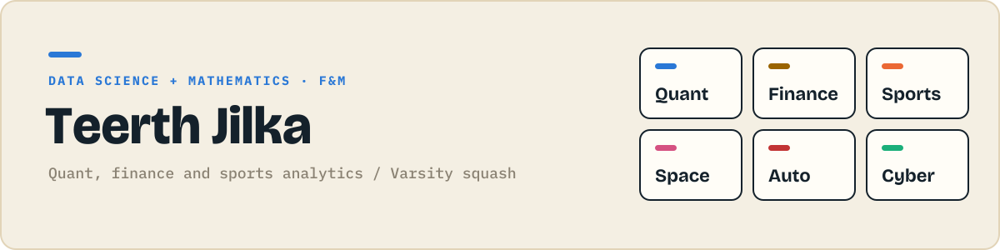

### Hi, I'm Teerth 👋

- 🎓 Data Science and Mathematics at **Franklin & Marshall College**
- 📈 Interested in quant, finance and sports analytics
- 🏆 Varsity squash, Maharashtra State champion
- 📍 From Pune, India. Now in Lancaster, PA

## 🧩 Project collections

Six collections, ten small projects each, building from simple scripts to machine learning. **1 of 60 done.**

<table>
<tr>
<td width="50%"> 🟩⬜⬜⬜⬜⬜⬜⬜⬜⬜ &nbsp;<b>1/10</b></td>
<td width="50%"> ⬜⬜⬜⬜⬜⬜⬜⬜⬜⬜ &nbsp;<b>0/10</b></td>
</tr>
<tr>
<td width="50%"> ⬜⬜⬜⬜⬜⬜⬜⬜⬜⬜ &nbsp;<b>0/10</b></td>
<td width="50%"> ⬜⬜⬜⬜⬜⬜⬜⬜⬜⬜ &nbsp;<b>0/10</b></td>
</tr>
<tr>
<td width="50%"> ⬜⬜⬜⬜⬜⬜⬜⬜⬜⬜ &nbsp;<b>0/10</b></td>
<td width="50%"> ⬜⬜⬜⬜⬜⬜⬜⬜⬜⬜ &nbsp;<b>0/10</b></td>
</tr>
</table>

## 🚀 Latest

- **[Compound interest calculator](https://github.com/JilkaTeerth/quant-projects/tree/main/01-compound-interest)** · Shows how money grows year by year at a fixed rate.

**Up next:** Loan EMI calculator (Finance Projects)

## 🛠️ Tools

        

## 🤝 Connect

